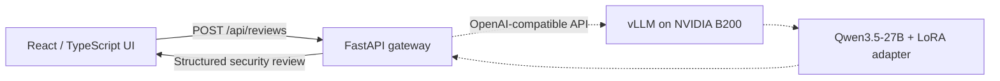
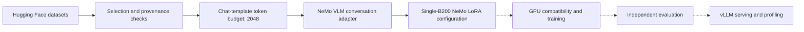

# PatchReason

**AI-assisted JavaScript and TypeScript security review built around Qwen3.5-27B, NVIDIA NeMo AutoModel, and a single NVIDIA B200 Blackwell GPU.**

PatchReason is an engineering case study built from a simulated stakeholder requirement. It does not claim a paying client, a commercial production deployment, or measured improvements from fine-tuning that has not yet been executed.

## Project overview

PatchReason implements a React and FastAPI code-security-review application and a reproducible model-adaptation workflow. Its target deployment uses **Qwen3.5-27B on a single NVIDIA B200**, trained with **NVIDIA NeMo AutoModel + LoRA** and served through **vLLM**.

The following project deliverables are implemented and versioned:

- React/TypeScript code-review interface with source editor, line highlighting, model selection, connection state, processing feedback, and structured results.
- Python FastAPI review gateway with input validation, response schemas, API endpoints, and automated tests.
- Deterministic JavaScript vulnerability-data selection, provenance manifests, duplicate screening, and tokenizer-aware sequence budgeting.
- A 2,048-token NeMo conversational training export containing 3,953 training examples and 294 validation examples.
- Versioned NeMo AutoModel single-GPU LoRA configuration, static validation, synthetic compatibility data, and GPU environment/telemetry utilities.
- Independent evaluation design and documentation for measurements and reproducibility.

**B200 execution status:** The single-GPU recipe has passed local static checks and dataset-format validation. **Model loading, LoRA training, vLLM serving, model-quality measurements, and GPU profiling on the B200 have not yet been verified.** The browser and API are implemented, but the target 27B/B200 serving integration is not claimed as operational.

## Technology stack

| Layer | Technology | Project implementation |
| --- | --- | --- |
| Foundation model | [Qwen3.5-27B](https://huggingface.co/Qwen/Qwen3.5-27B) | Model and tokenizer selected; reproducible configuration |
| Fine-tuning | [NVIDIA NeMo AutoModel](https://docs.nvidia.com/nemo/automodel/latest/) + LoRA | Versioned single-GPU recipe and local static validator |
| GPU target | 1× NVIDIA B200 Blackwell via [Vast.ai](https://vast.ai/) | GPU environment gate, training handoff, telemetry utilities |
| Inference service | [vLLM](https://docs.vllm.ai/) | Serving architecture; B200 integration to be verified |
| Evaluation | [Promptfoo](https://www.promptfoo.dev/docs/) + custom metrics | Evaluation specification, data partitions, result schemas |
| GPU profiling | [NVIDIA Nsight Systems](https://developer.nvidia.com/nsight-systems), `nvtop`, `nvidia-smi` | Capture workflow and documentation |
| API | Python, FastAPI, Pydantic, HTTPX | Implemented HTTP gateway in `api/` |
| Frontend | React, Vite, TypeScript, Tailwind CSS | Implemented UI in `app/` |
| Data engineering | Python, Hugging Face Datasets, Qwen tokenizer | Scripts and versioned audits |

## Architecture

### Target application architecture



The React and FastAPI components are implemented. **Dotted links indicate the target B200 serving integration, not a completed deployment.**

### Model adaptation pipeline



The data-preparation and static-configuration stages are documented and reproducible. GPU-dependent execution stages require real artifacts before any performance or training outcome is reported.

## Datasets and source provenance

The project references two distinct public Hugging Face datasets. They serve different purposes and are not combined into an implicitly approved training corpus.

| Source | Hugging Face | Pinned source revision | Role |
| --- | --- | --- | --- |
| `sijjeel/js-vuln-dataset` | [Dataset card](https://huggingface.co/datasets/sijjeel/js-vuln-dataset) | [`7f36e5e`](https://huggingface.co/datasets/sijjeel/js-vuln-dataset/tree/7f36e5e1f0868d963c109acae5db4b094950675b) | Binary vulnerable/safe JavaScript classification data |
| `rgaucher/security-vuln-patches` | [Dataset card](https://huggingface.co/datasets/rgaucher/security-vuln-patches) | [`cc56b3a`](https://huggingface.co/datasets/rgaucher/security-vuln-patches/tree/cc56b3a3f17cc6a18c8f385694c14646502999fa) | Vulnerability-patch/CWE candidate screening and source-quality assessment |

### Binary JavaScript dataset

The [upstream dataset](https://huggingface.co/datasets/sijjeel/js-vuln-dataset) contains 9,987 records across its original train (6,990), validation (1,498), and test (1,499) partitions. PatchReason selected a balanced subset while preserving the source partitions.

| Partition | Source records | Selected | Vulnerable | Safe |
| --- | ---: | ---: | ---: | ---: |
| Training | 6,990 | 4,000 | 2,000 | 2,000 |
| Validation | 1,498 | 300 | 150 | 150 |
| Held-out evaluation | 1,499 | 300 | 150 | 150 |

The selection is deterministic; the recorded manifest reports zero normalized exact duplicates across the selected partitions. This does **not** establish repository-level independence or exclude semantically near-identical examples.

The Qwen3.5-27B chat template and tokenizer were then applied to establish a **2,048-token** sequence budget, including the model response. Over-budget samples were **excluded**, rather than silently truncated:

| Partition | Before budget | Retained | Vulnerable | Safe | Excluded |
| --- | ---: | ---: | ---: | ---: | ---: |
| Training | 4,000 | **3,953** | 1,974 | 1,979 | 47 |
| Validation | 300 | **294** | 146 | 148 | 6 |
| Held-out evaluation | 300 | **300 reserved** | 150 | 150 | Not included in the training export |

The held-out partition remains separate from training and validation. The tokenizer revision used for the recorded budget is `fc05daec18b0a78c049392ed2e771dde82bdf654`.

Source data, derived private training files, and handoff archives remain outside the public repository. Reproducibility metadata is versioned in:

- [`results/data_intake/js_binary_manifest.json`](results/data_intake/js_binary_manifest.json)
- [`results/data_intake/qwen35_token_audit.json`](results/data_intake/qwen35_token_audit.json)
- [`results/data_intake/sequence_budget_2048.json`](results/data_intake/sequence_budget_2048.json)
- [`docs/BINARY_DATASET_PIPELINE.md`](docs/BINARY_DATASET_PIPELINE.md)
- [`docs/SEQUENCE_LENGTH_POLICY.md`](docs/SEQUENCE_LENGTH_POLICY.md)

### Security patch / CWE candidate dataset

The [security-vuln-patches collection](https://huggingface.co/datasets/rgaucher/security-vuln-patches) contains **355** source records. PatchReason identified **71** JavaScript/TypeScript patch candidates across **14 CWE categories** for closer review. These are **screening candidates**, not 71 confirmed security findings and not approved LoRA training items.

Manual inspection found problematic source classifications, reinforcing the need for patch-level verification rather than relying solely on supplied labels. Evidence and decisions are documented in:

- [`docs/CWE_SCOPE_REVIEW.md`](docs/CWE_SCOPE_REVIEW.md)
- [`docs/CANDIDATE_REVIEW.md`](docs/CANDIDATE_REVIEW.md)
- [`docs/DATASET_METHODOLOGY.md`](docs/DATASET_METHODOLOGY.md)

### Data-quality and licensing gate

The Hugging Face pages declare **CC BY 4.0** for `sijjeel/js-vuln-dataset` and **MIT** for `rgaucher/security-vuln-patches`. Those dataset-level declarations do not replace checking the origin and applicable rights of underlying repository code.

Upstream vulnerable/safe labels have not been independently verified for every record. Repository/CVE overlap, semantic near-duplicates, source-label validity, and per-repository code rights require further review before training approval. Binary labels alone do not supervise CWE classification, severity, or remediation generation.

## Run the application locally

The frontend and HTTP API can be started independently of the target B200 deployment. A live review through Qwen3.5-27B becomes available only after an inference service is configured and verified.

Requirements: macOS or Linux with Python 3.10+ and Node.js 20+.

Start and check the API from the repository root:

```bash
python3 -m venv .venv
source .venv/bin/activate
python3 -m pip install -r api/requirements-dev.txt
cp -n api/.env.example api/.env
python3 -m pytest -q api/tests
python3 -m uvicorn api.main:app --host 127.0.0.1 --port 8000 --reload
```

Start the React application in another terminal:

```bash
cd app
npm ci
printf '%s\n' 'VITE_API_BASE_URL=http://127.0.0.1:8000' > .env.local
npm run check
npm run build
npm run dev
```

Open `http://127.0.0.1:5173/review`. The UI reports gateway and model readiness, and only permits live review when a working inference provider is connected. The API includes `GET /api/status`, `GET /api/models`, and `POST /api/reviews`. FastAPI documentation is available at `http://127.0.0.1:8000/docs`.

The intended B200 serving layer is vLLM. Its deployment, adapter compatibility, and integration with the current gateway are separate acceptance checks and are not yet certified by the local UI/API tests.

## Training configuration and evaluation

The repository includes `config/nemo/qwen35_27b_b200_lora_candidate.yaml` and compatibility tooling targeting Qwen3.5-27B, BF16, LoRA rank 16, alpha 32, tensor/pipeline parallelism 1/1, and a 2,048-token budget. Static checks and VLM conversation-format conversion passed for 3,953 training and 294 validation items. A two-step GPU compatibility check using original synthetic examples is defined but has not yet been executed on the B200.

The single-B200 configuration is an adaptation of NVIDIA's published distributed Qwen3.5 recipe, not an NVIDIA-validated single-GPU recipe. The training gate also requires source-label and license review.

The evaluation design includes precision, recall, F1, false positives, JSON-contract compliance, and latency, using independent held-out data. No measured comparative improvement is claimed until an actual base-versus-adapter evaluation exists. GPU traces and model checkpoints likewise require real execution evidence.

## Repository structure

```text
api/                  FastAPI review gateway and tests
app/                  React / TypeScript web application
config/nemo/          Single-GPU LoRA and compatibility configuration candidates
configs/              Evaluation and other project configuration
datasets/             Data contracts and original reference code examples
docs/                 Architecture, data provenance, decisions, deployment
results/data_intake/  Versioned manifests and quality reports
screenshots/          Captures of the application and verified GPU execution
scripts/              Ingestion, audits, packaging, NeMo and GPU utilities
```

## Documentation and technical references

- [Project brief](docs/PROJECT_BRIEF.md)
- [System architecture](docs/ARCHITECTURE.md)
- [Engineering decisions](docs/DECISIONS.md)
- [HTTP inference gateway](docs/LOCAL_INFERENCE_GATEWAY.md)
- [Web application](app/README.md)
- [Data ingestion](docs/DATA_INGESTION.md)
- [Dataset sources](docs/DATASET_SOURCES.md)
- [Data processing methodology](docs/DATASET_METHODOLOGY.md)
- [Sequence-length policy](docs/SEQUENCE_LENGTH_POLICY.md)
- [Single-B200 NeMo configuration](docs/SINGLE_B200_LORA_CANDIDATE.md)
- [B200 compatibility plan](docs/B200_COMPATIBILITY_PLAN.md)
- [GPU observability](docs/OBSERVABILITY.md)
- [Evaluation methodology](docs/EVALUATION_PLAN.md)
- [NVIDIA NeMo AutoModel documentation](https://docs.nvidia.com/nemo/automodel/latest/)
- [NVIDIA NGC NeMo AutoModel container](https://catalog.ngc.nvidia.com/orgs/nvidia/-/containers/nemo-automodel/26.10.00)

## Security and project scope

Do not commit proprietary source code, private dataset exports, model weights, access tokens, or credentials. Model-generated security findings may include false positives or false negatives; PatchReason assists, but does not replace, expert review. The project brief is simulated and makes no claim of a paying customer.
