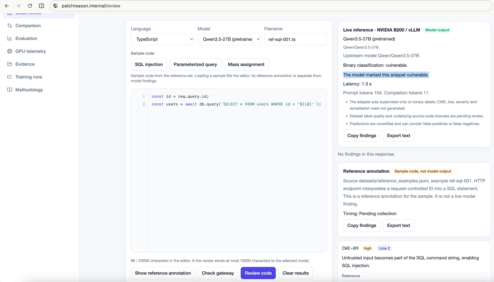
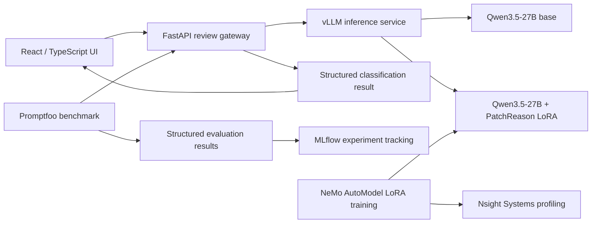
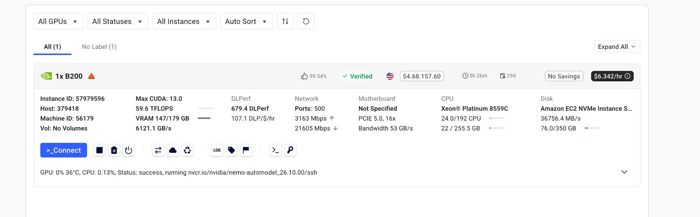
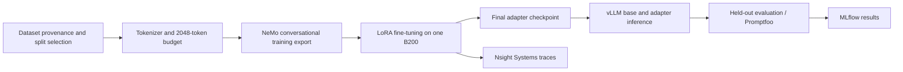
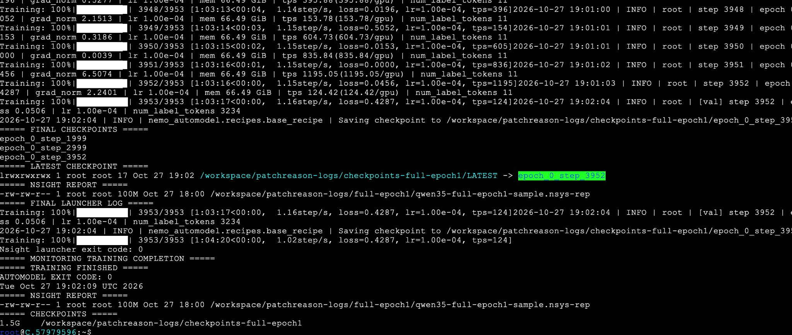
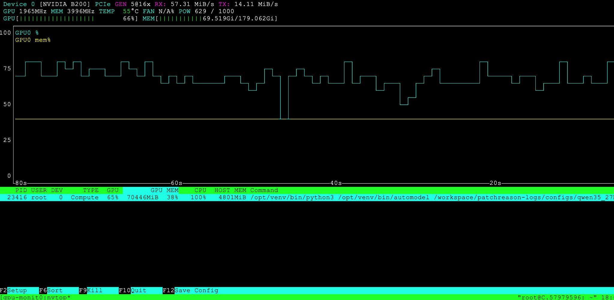
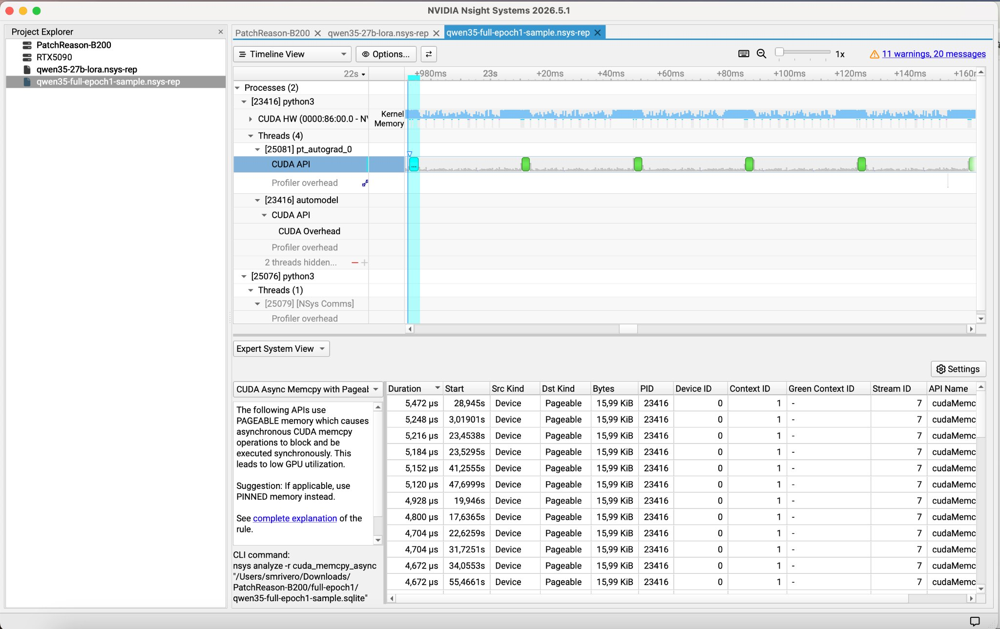
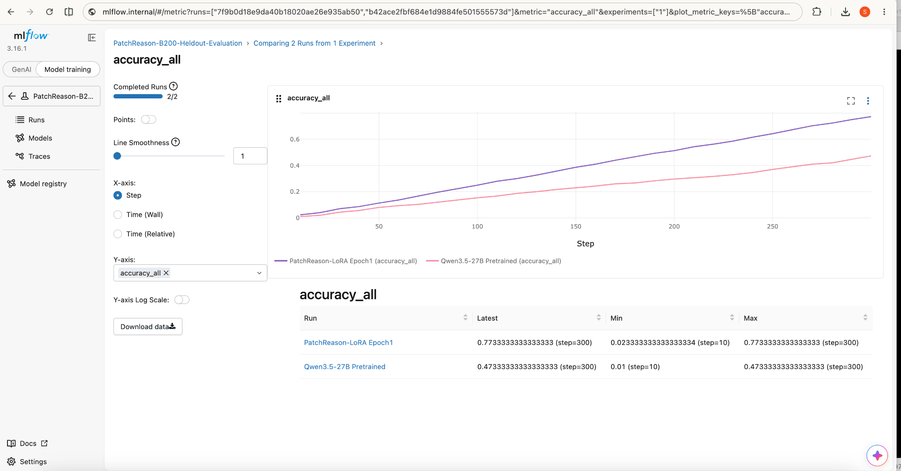
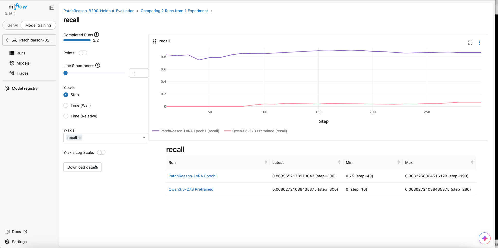

# PatchReason

**GPU-accelerated code-security classification with Qwen3.5-27B, NVIDIA NeMo AutoModel, LoRA, vLLM, and NVIDIA B200 Blackwell.**

PatchReason is an end-to-end applied ML engineering project covering dataset preparation, single-GPU parameter-efficient fine-tuning, model serving, quantitative evaluation, inference benchmarking, and GPU profiling. A React/TypeScript client and FastAPI gateway provide an interface for reviewing JavaScript and TypeScript source files.

Developed against a simulated product requirement, the project includes executed B200 fine-tuning, adapter checkpointing, inference serving, evaluation, and GPU profiling.

## Application preview



The React interface connects to a FastAPI gateway that routes JavaScript and TypeScript snippets to the selected vLLM model. Model classifications and separately sourced reference annotations are identified distinctly in the UI.

## Engineering highlights

| Area | Implementation and verified evidence |
| --- | --- |
| Foundation model | [Qwen3.5-27B](https://huggingface.co/Qwen/Qwen3.5-27B) |
| GPU | One NVIDIA B200 Blackwell GPU (Vast.ai) |
| Fine-tuning | [NVIDIA NeMo AutoModel](https://docs.nvidia.com/nemo/automodel/latest/) with LoRA; one completed epoch; final checkpoint at `epoch_0_step_3952` |
| Data | 3,953 training and 294 validation examples after a 2,048-token sequence-budget audit |
| Serving | [vLLM](https://docs.vllm.ai/) serving the base model and a PatchReason LoRA adapter through the FastAPI gateway |
| Evaluation | 300-example held-out Base vs LoRA evaluation, MLflow experiment tracking and API-level evaluation with Promptfoo |
| Benchmark | API-level inference testing with structured outputs and token/latency telemetry |
| Profiling | [NVIDIA Nsight Systems](https://developer.nvidia.com/nsight-systems) `.nsys-rep` captures, including a full-epoch training sample |

## System architecture



The live gateway accepted `POST /api/reviews` with a source-code payload, language, filename and model identifier. It exposed model discovery, status, evaluation summary, runs and GPU telemetry endpoints. The deployed LoRA was trained for **binary vulnerable/safe classification**. CWE identification, line-level evidence, severity and remediation generation were not supervised outputs of this adapter; those fields should not be interpreted as independently validated model findings.

## Dataset engineering

Two Hugging Face datasets were examined for different purposes. Each source was assessed for a distinct stage of the data pipeline.

| Source | Pinned revision | Use |
| --- | --- | --- |
| [`sijjeel/js-vuln-dataset`](https://huggingface.co/datasets/sijjeel/js-vuln-dataset) | [`7f36e5e`](https://huggingface.co/datasets/sijjeel/js-vuln-dataset/tree/7f36e5e1f0868d963c109acae5db4b094950675b) | Binary JavaScript vulnerable/safe examples for training and evaluation partitions |
| [`rgaucher/security-vuln-patches`](https://huggingface.co/datasets/rgaucher/security-vuln-patches) | [`cc56b3a`](https://huggingface.co/datasets/rgaucher/security-vuln-patches/tree/cc56b3a3f17cc6a18c8f385694c14646502999fa) | Separate security-patch/CWE candidate screening; Screening and taxonomy analysis |

The binary source contained 9,987 records across its original training (6,990), validation (1,498), and test (1,499) partitions. Deterministic selection preserved partition boundaries and balanced the two labels.

| Partition | Initial selection | Vulnerable | Safe | After 2,048-token budget |
| --- | ---: | ---: | ---: | ---: |
| Training | 4,000 | 2,000 | 2,000 | **3,953** (1,974 vulnerable; 1,979 safe) |
| Validation | 300 | 150 | 150 | **294** (146 vulnerable; 148 safe) |
| Held-out test | 300 reserved | 150 | 150 | Kept outside the training export |

The token budget used Qwen's tokenizer and chat template and included the expected model response. Samples beyond the 2,048-token budget were excluded rather than silently truncated: 47 training and 6 validation examples. The recorded tokenizer revision is `fc05daec18b0a78c049392ed2e771dde82bdf654`. The selection manifest reported no normalized exact duplicates across selected partitions; with split-level exact-duplicate auditing recorded in the provenance manifest.

The separate patch dataset contained 355 source records. Screening identified 71 JavaScript/TypeScript candidates spanning 14 CWE categories. These candidates informed dataset screening and CWE taxonomy work.

The public repository includes provenance manifests, audit reports and pipeline documentation. Original dataset records remain at their linked sources.

Relevant repository files: [`docs/BINARY_DATASET_PIPELINE.md`](docs/BINARY_DATASET_PIPELINE.md), [`docs/DATASET_METHODOLOGY.md`](docs/DATASET_METHODOLOGY.md), [`docs/SEQUENCE_LENGTH_POLICY.md`](docs/SEQUENCE_LENGTH_POLICY.md), [`results/data_intake/js_binary_manifest.json`](results/data_intake/js_binary_manifest.json), [`results/data_intake/sequence_budget_2048.json`](results/data_intake/sequence_budget_2048.json).

## Training on NVIDIA B200



The training environment used one rented NVIDIA B200 Blackwell GPU with the NeMo AutoModel container. The instance and training environment are documented alongside the captured training and profiling artifacts.


The single-GPU adaptation workflow used NeMo AutoModel with Qwen3.5-27B and a LoRA configuration targeting BF16 computation, rank 16, alpha 32, and a 2,048-token sequence budget. Tensor and pipeline parallelism were configured as 1/1 for the single GPU. The recipe and validation utilities are maintained under `config/nemo/` and `scripts/`.



A full one-epoch training run completed with a final checkpoint at **`epoch_0_step_3952`**. Preserved checkpoints include steps 1999, 2999 and 3952. The final checkpoint contains `adapter_model.safetensors`, `adapter_config.json`, tokenizer assets, the run configuration, loss records, scheduler and optimizer states. The final checkpoint directory occupied approximately 498 MB in the captured instance. The adapter is stored separately from the Qwen3.5-27B foundation-model weights.



The training launcher completed 3,953 steps and saved the final adapter checkpoint at step 3952. The terminal capture also identifies the preserved Nsight sample report.



The `nvtop` capture shows B200 GPU activity and memory allocation during the training run.



Nsight Systems traces provide CUDA execution timelines, API activity and memory-transfer profiling for performance analysis.

Nsight Systems traces were captured for CUDA smoke testing, initial LoRA work, a 27B training run, a 32-example pilot, and a full-epoch sample. The full-epoch sample report was approximately 100 MB. They support inspection of GPU kernels, CPU activity, scheduling and memory operations.

## Evaluation and measured results

Evaluation was performed through a separate held-out workflow and a later API-level Promptfoo benchmark. MLflow holds the held-out evaluation experiment and the benchmark experiment. The held-out outputs include `summary.json`, `predictions.jsonl`, `predictions.csv`, and base/LoRA confusion-matrix SVGs. The final held-out accuracy and recall metrics are summarized below, based on the two MLflow runs.

### Held-out evaluation tracking

The held-out evaluation ran on a reserved **300-example** JavaScript classification partition, separate from the training and validation exports. MLflow recorded model-level metrics at successive evaluated-example counts (`step`), allowing the pretrained and adapted models to be compared on the same held-out set.

| Held-out evaluation metric (final, step 300) | Qwen3.5-27B pretrained | PatchReason LoRA, epoch 1 |
| --- | ---: | ---: |
| Accuracy (`accuracy_all`) | 47.3% | **77.3%** |
| Recall (`recall`) | 6.8% | **87.0%** |

These values are taken from the final MLflow readings for the held-out evaluation, not from training loss or the separate Promptfoo scenario tests. The `accuracy_all` plot rises as additional examples are scored; it should be interpreted as the **accumulated share of correct predictions out of the 300-example total**, not as a training-learning curve. The held-out comparison reports a 30.0 percentage-point accuracy increase and an 80.2 percentage-point recall increase for the adapted model.





### Inference evaluation tooling

Promptfoo exercised both vLLM-backed variants through the FastAPI gateway with 240 API requests, recording structured classifications, latency and token usage. Results can be inspected case by case in the Promptfoo UI. The held-out dataset remains the source for the model-quality figures above.

The gateway recorded latency and token counts, while MLflow captured evaluation history and run-level metrics. These measurements were collected through the same NVIDIA B200 deployment. The gateway logs token counts and server-reported request latency.

## Experimental evidence

The screenshots document the React application, B200 execution environment, completed training, GPU telemetry, Nsight Systems timeline and MLflow held-out evaluation. The recorded evidence can be paired with the archived artifacts and run metadata.

## Run the application locally

Requirements: macOS or Linux, Python 3.10+, and a Node.js version compatible with the repository's application dependencies. A live model review requires an accessible inference backend; the local frontend and gateway can also be tested independently.

From the repository root:

```bash
python3 -m venv .venv
source .venv/bin/activate
python3 -m pip install -r api/requirements-dev.txt
cp -n api/.env.example api/.env
python3 -m pytest -q api/tests
python3 -m uvicorn api.main:app --host 127.0.0.1 --port 8000 --reload
```

In a second terminal:

```bash
cd app
npm ci
printf '%s\n' 'VITE_API_BASE_URL=http://127.0.0.1:8000' > .env.local
npm run check
npm run build
npm run dev
```

Open `http://127.0.0.1:5173/review`. The gateway provides `/api/status`, `/api/models`, `/api/reviews`, and API documentation at `/docs` when running locally.

For experiment tracking, [MLflow](https://mlflow.org/docs/latest/ml/tracking/) supports run comparison and archived metrics. [Promptfoo](https://www.promptfoo.dev/docs/) provides the prompt/test evaluation UI, and [Nsight Systems](https://developer.nvidia.com/nsight-systems) opens `.nsys-rep` files for profiling analysis. A compatible vLLM service is required for live 27B model inference.

## Repository organization

```text
api/                   FastAPI gateway and tests
app/                   React / TypeScript application
config/nemo/           NeMo configuration
configs/               Evaluation configuration
datasets/              Data contracts and reference examples
docs/                  Architecture, provenance and technical decisions
results/data_intake/   Versioned manifests and audits
screenshots/           Verified application, evaluation and profiling captures
scripts/               Dataset, training, packaging and GPU utilities
```

## Technical documentation

- [Architecture](docs/ARCHITECTURE.md)
- [Engineering decisions](docs/DECISIONS.md)
- [Data ingestion](docs/DATA_INGESTION.md)
- [Dataset sources](docs/DATASET_SOURCES.md)
- [Dataset methodology](docs/DATASET_METHODOLOGY.md)
- [B200 configuration](docs/SINGLE_B200_LORA_CANDIDATE.md)
- [GPU observability](docs/OBSERVABILITY.md)
- [Evaluation methodology](docs/EVALUATION_PLAN.md)
- [NVIDIA NeMo AutoModel](https://docs.nvidia.com/nemo/automodel/latest/)
- [NVIDIA NeMo AutoModel container](https://catalog.ngc.nvidia.com/orgs/nvidia/-/containers/nemo-automodel/26.10.00)

## Reproducibility

The repository contains the source application, data preparation and validation tooling, versioned model configuration, and technical documentation for the single-B200 workflow. The training objective is binary vulnerable/safe classification. External dataset and model links identify the original sources; the public release does not distribute credentials, private data exports, or foundation-model weights.
