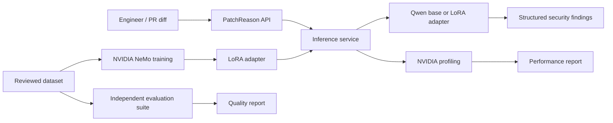

# PatchReason

**AI-assisted source code security review, specialized with NVIDIA NeMo and LoRA.**

> **Project context:** This repository implements an illustrative client requirement created as a professional engineering case study. It does not represent a paid client engagement or a deployed commercial service.

## Business problem

Engineering teams review TypeScript/Node.js changes under delivery pressure. Manual reviews can overlook authorization flaws, injection, unsafe object updates, and insufficient input handling. Generic LLMs can help but may produce unsupported findings or inconsistent structured output.

**Objective:** Build a code-review service that analyzes supplied code or pull-request diffs, identifies supported security findings, and produces actionable remediation guidance. Investigate whether task-specific LoRA adaptation improves security review quality relative to the same foundation model with a carefully designed prompt.

## Initial scope

- TypeScript / Node.js API code, with emphasis on authorization, SQL injection, and mass assignment.
- Structured findings: CWE category, severity, evidence, explanation, proposed remediation.
- Correct handling of secure snippets (no finding).
- Baseline model vs. LoRA-adapted model comparison using held-out, repository-disjoint evaluation data.
- Response-quality analysis and NVIDIA GPU performance profiling.
- A simple comparison UI and an HTTP API.

Out of scope initially: automated merges, production deployment, guaranteed vulnerability coverage, complete repository semantic analysis, or replacing human security review.

## Proposed stack

| Layer | Technology | Status |
|---|---|---|
| Model | [Qwen3.5-27B](https://huggingface.co/Qwen/Qwen3.5-27B) | Selected; deployment compatibility pending |
| Fine-tuning | [NVIDIA NeMo AutoModel](https://docs.nvidia.com/nemo/automodel/latest/) + LoRA | Planned |
| Compute | 1x NVIDIA B200 Blackwell through [Vast.ai](https://vast.ai/) | Not rented |
| Inference | [vLLM](https://docs.vllm.ai/) | Planned |
| Evaluation | [Promptfoo](https://www.promptfoo.dev/docs/) + custom metrics | Design stage |
| GPU profiling | [NVIDIA Nsight Systems](https://developer.nvidia.com/nsight-systems) | Planned |
| API | Python | Planned |
| Frontend | React | Planned |

**Important compatibility gate:** NVIDIA's published Qwen3.5-27B NeMo AutoModel recipe uses a distributed topology (`tp_size=4`, `pp_size=4`, two nodes). This is **not** a validated single-B200 LoRA configuration. We must derive and verify an appropriate single-GPU recipe before production training. Do not claim this as working yet.

## Architecture



## Repository structure

```text
api/                  HTTP service (planned)
app/                  React comparison interface (planned)
configs/nemo/         Versioned NeMo configuration work
configs/promptfoo/    Evaluation provider configuration
datasets/             Data contract and synthetic reference examples
 docs/                 Scope, architecture, decisions, evaluation and deployment
 results/              Measured output tables (no fabricated numbers)
 screenshots/          Evidence captured from the actual execution
 scripts/              Local data validation and setup utilities
```

## Getting started on macOS

No GPU and no third-party Python packages are required for the initial dataset validation:

```bash
cd PatchReason
python3 scripts/validate_dataset.py datasets/reference_examples.jsonl
```

When curated examples and source provenance are ready, version dataset manifests while keeping private code, credentials, downloaded model weights and large generated artifacts outside Git.

## Quality metrics

- Finding-level precision, recall and F1.
- False-positive rate on benign samples.
- JSON contract compliance.
- Correct CWE classification and remediation usefulness.
- GPU memory usage, training throughput, inference tokens/s, latency percentiles.

The optimized-prompt baseline and LoRA model will use **identical held-out items**. Report both successes and regressions; performance claims must link to actual recorded results.

## Project stage

**Design and local preparation.** No model has been fine-tuned for this project, no benchmark metrics have been collected, and no B200 session has been started.

## Documentation

- [Illustrative client brief](docs/PROJECT_BRIEF.md)
- [System architecture](docs/ARCHITECTURE.md)
- [Architecture decisions and open blockers](docs/DECISIONS.md)
- [Dataset specification](datasets/README.md)
- [Evaluation protocol](docs/EVALUATION_PLAN.md)
- [Vast.ai and NVIDIA deployment readiness](docs/DEPLOYMENT.md)

## Official references

- [NeMo AutoModel release and container, NVIDIA NGC](https://catalog.ngc.nvidia.com/orgs/nvidia/-/containers/nemo-automodel/26.10.00)
- [NeMo AutoModel installation guide](https://docs.nvidia.com/nemo/automodel/latest/get-started/installation)
- [Qwen3.5-27B NeMo model support and distributed recipe](https://docs.nvidia.com/nemo/automodel/latest/model-coverage/vision-language-models/qwen/Qwen3.5-27B)
- [Qwen3.5-27B model card](https://huggingface.co/Qwen/Qwen3.5-27B)
- [Promptfoo OpenAI-compatible API configuration](https://www.promptfoo.dev/docs/providers/openai/)
- [NVIDIA Nsight Systems](https://developer.nvidia.com/nsight-systems)

## Data and security

Use only code you are licensed or authorized to use. Remove credentials, tokens, personal data and customer information. Dataset sources, licenses and curation decisions must be documented. Model-generated suggestions require developer review.

## External dataset intake

PatchReason ingests public-source vulnerability-fix records into a private review queue.
The ingestion scripts preserve provenance and source revisions. Ingested data are
**not** automatically labelled as approved training examples. Dataset metadata
may be committed; unreviewed upstream code stays outside Git.

- [Ingestion workflow and commands](docs/DATA_INGESTION.md)
- [Data-source rationale](docs/DATASET_SOURCES.md)
- [Curation methodology](docs/DATASET_METHODOLOGY.md)

No measured fine-tuning improvements or externally sourced training records are
claimed until their provenance and annotation status have been verified.

### Security weakness coverage

[PatchReason CWE Scope Review](docs/CWE_SCOPE_REVIEW.md) documents how public JavaScript/TypeScript security changes are screened across CWE categories, with reproducible reports and human-review gates. The dataset intake is not automatically approved for model adaptation.

- [Security candidate review and coverage](docs/CANDIDATE_REVIEW.md)

- [Binary vulnerability data pipeline](docs/BINARY_DATASET_PIPELINE.md)
