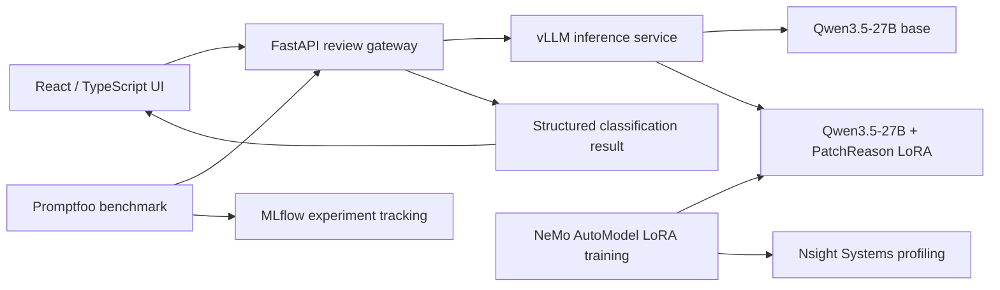
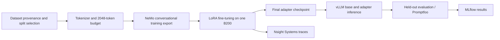
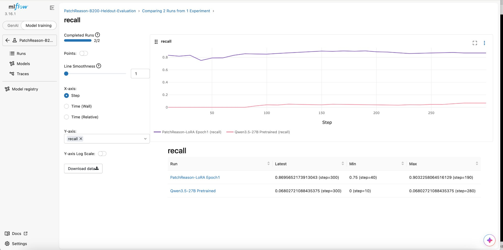
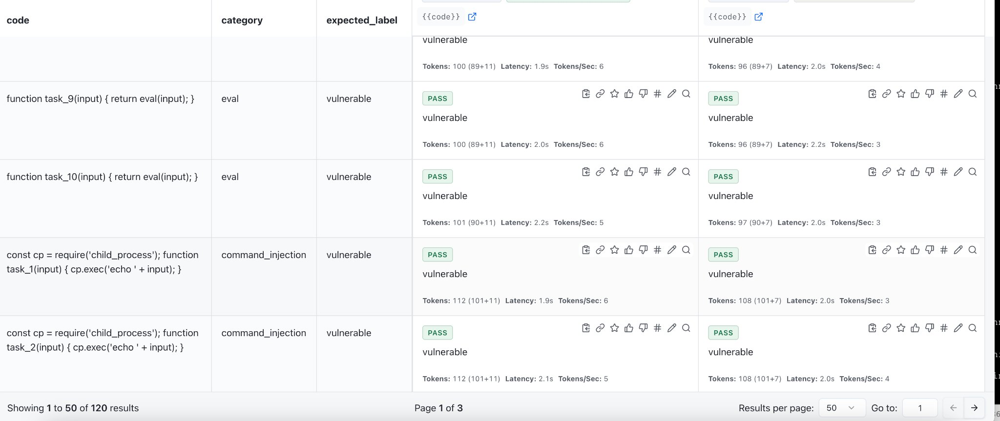

# PatchReason

**GPU-accelerated code-security classification with Qwen3.5-27B, NVIDIA NeMo AutoModel, LoRA, vLLM, and NVIDIA B200 Blackwell.**

PatchReason is an end-to-end applied ML engineering project covering dataset preparation, single-GPU parameter-efficient fine-tuning, model serving, quantitative evaluation, inference benchmarking, and GPU profiling. A React/TypeScript client and FastAPI gateway provide an interface for reviewing JavaScript and TypeScript source files.

The project is framed around a simulated product requirement, not a claimed commercial deployment. The B200 training, checkpoint generation, inference serving, evaluation, and profiling steps described below were executed and their artifacts were retained.

## Application preview


The React interface connects to a FastAPI gateway that routes JavaScript and TypeScript snippets to the selected vLLM model. Model classifications and separately sourced reference annotations are identified distinctly in the UI.

## Engineering highlights

| Area | Implementation and verified evidence |
| --- | --- |
| Foundation model | [Qwen3.5-27B](https://huggingface.co/Qwen/Qwen3.5-27B) |
| GPU | One NVIDIA B200 Blackwell GPU (Vast.ai) |
| Fine-tuning | [NVIDIA NeMo AutoModel](https://docs.nvidia.com/nemo/automodel/latest/) with LoRA; one completed epoch; final checkpoint at `epoch_0_step_3952` |
| Data | 3,953 training and 294 validation examples after a 2,048-token sequence-budget audit |
| Serving | [vLLM](https://docs.vllm.ai/) serving the base model and a PatchReason LoRA adapter through the FastAPI gateway |
| Evaluation | Independent held-out evaluation artifacts; MLflow experiment tracking; Promptfoo code-classification benchmark |
| Benchmark | 120 test cases per model (240 requests); 0 transport errors in the completed comparison |
| Profiling | [NVIDIA Nsight Systems](https://developer.nvidia.com/nsight-systems) `.nsys-rep` captures, including a full-epoch training sample |

## System architecture



The live gateway accepted `POST /api/reviews` with a source-code payload, language, filename and model identifier. It exposed model discovery, status, evaluation summary, runs and GPU telemetry endpoints. The deployed LoRA was trained for **binary vulnerable/safe classification**. CWE identification, line-level evidence, severity and remediation generation were not supervised outputs of this adapter; those fields should not be interpreted as independently validated model findings.

## Dataset engineering

Two Hugging Face datasets were examined for different purposes. They were not indiscriminately merged into one training corpus.

| Source | Pinned revision | Use |
| --- | --- | --- |
| [`sijjeel/js-vuln-dataset`](https://huggingface.co/datasets/sijjeel/js-vuln-dataset) | [`7f36e5e`](https://huggingface.co/datasets/sijjeel/js-vuln-dataset/tree/7f36e5e1f0868d963c109acae5db4b094950675b) | Binary JavaScript vulnerable/safe examples for training and evaluation partitions |
| [`rgaucher/security-vuln-patches`](https://huggingface.co/datasets/rgaucher/security-vuln-patches) | [`cc56b3a`](https://huggingface.co/datasets/rgaucher/security-vuln-patches/tree/cc56b3a3f17cc6a18c8f385694c14646502999fa) | Separate security-patch/CWE candidate screening; **not** included as approved LoRA training examples |

The binary source contained 9,987 records across its original training (6,990), validation (1,498), and test (1,499) partitions. Deterministic selection preserved partition boundaries and balanced the two labels.

| Partition | Initial selection | Vulnerable | Safe | After 2,048-token budget |
| --- | ---: | ---: | ---: | ---: |
| Training | 4,000 | 2,000 | 2,000 | **3,953** (1,974 vulnerable; 1,979 safe) |
| Validation | 300 | 150 | 150 | **294** (146 vulnerable; 148 safe) |
| Held-out test | 300 reserved | 150 | 150 | Kept outside the training export |

The token budget used Qwen's tokenizer and chat template and included the expected model response. Samples beyond the 2,048-token budget were excluded rather than silently truncated: 47 training and 6 validation examples. The recorded tokenizer revision is `fc05daec18b0a78c049392ed2e771dde82bdf654`. The selection manifest reported no normalized exact duplicates across selected partitions; this does not establish repository-level independence or eliminate semantic near-duplicates.

The separate patch dataset contained 355 source records. Screening identified 71 JavaScript/TypeScript candidates spanning 14 CWE categories. They remained candidates requiring manual source-level verification, not confirmed security defects or fine-tuning items.

Dataset-level license declarations and upstream classification labels do not independently establish rights for each underlying source file or correctness of its vulnerability label. The public repository retains selection manifests, audit results and methodology rather than redistributing private training exports or source-code collections.

Relevant repository files: [`docs/BINARY_DATASET_PIPELINE.md`](docs/BINARY_DATASET_PIPELINE.md), [`docs/DATASET_METHODOLOGY.md`](docs/DATASET_METHODOLOGY.md), [`docs/SEQUENCE_LENGTH_POLICY.md`](docs/SEQUENCE_LENGTH_POLICY.md), [`results/data_intake/js_binary_manifest.json`](results/data_intake/js_binary_manifest.json), [`results/data_intake/sequence_budget_2048.json`](results/data_intake/sequence_budget_2048.json).

## Training on NVIDIA B200


The training environment used one rented NVIDIA B200 Blackwell GPU with the NeMo AutoModel container. This is an instance configuration screenshot, not a performance measurement.


The single-GPU adaptation workflow used NeMo AutoModel with Qwen3.5-27B and a LoRA configuration targeting BF16 computation, rank 16, alpha 32, and a 2,048-token sequence budget. Tensor and pipeline parallelism were configured as 1/1 for the single GPU. The recipe and validation utilities are maintained under `config/nemo/` and `scripts/`.



A full one-epoch training run completed with a final checkpoint at **`epoch_0_step_3952`**. Preserved checkpoints include steps 1999, 2999 and 3952. The final checkpoint contains `adapter_model.safetensors`, `adapter_config.json`, tokenizer assets, the run configuration, loss records, scheduler and optimizer states. The final checkpoint directory occupied approximately 498 MB in the captured instance. This size refers to the checkpoint directory, not the underlying 27B base-model weights.


The training launcher completed 3,953 steps and saved the final adapter checkpoint at step 3952. The terminal capture also identifies the preserved Nsight sample report.


A live `nvtop` sample recorded GPU activity and device-memory use during training; the displayed point-in-time utilization is not an average over the full epoch.


Nsight Systems captured a CUDA timeline and flagged pageable-memory asynchronous copies as a profiling observation. This may warrant investigation of pinned-memory transfers; the capture alone does not quantify the total performance impact.

Nsight Systems traces were captured for CUDA smoke testing, initial LoRA work, a 27B training run, a 32-example pilot, and a full-epoch sample. The full-epoch sample report was approximately 100 MB. These traces provide source material for timeline analysis of GPU kernels, CPU activity, scheduling and memory operations; no specific GPU utilization percentage or throughput claim is made without extracting it from the traces.

## Evaluation and measured results

Evaluation was performed through a separate held-out workflow and a later API-level Promptfoo benchmark. MLflow holds the held-out evaluation experiment and the benchmark experiment. The held-out outputs include `summary.json`, `predictions.jsonl`, `predictions.csv`, and base/LoRA confusion-matrix SVGs. The precise held-out scores should be read from those artifacts before being added here; they are intentionally not inferred from unrelated benchmark numbers.

### Held-out evaluation tracking



MLflow recorded step-wise metrics for the separately held-out evaluation. This chart shows recall for that evaluation, not the later Promptfoo benchmark; the two test sets should not be mixed when reporting model quality.

### API-level classification benchmark

A reproducible Promptfoo configuration sent **120 code snippets to each model**, for **240 inference requests** in total. The test collection used 12 source-code patterns with 10 syntactic variants each: six vulnerable and six safe categories. It is a compact, pattern-based engineering benchmark rather than 120 independently curated security examples.

| Metric | Qwen3.5-27B base | Qwen3.5-27B + LoRA |
| --- | ---: | ---: |
| Requests | 120 | 120 |
| Valid model responses | 120 | 120 |
| Transport / response-format errors | 0 | 0 |
| Accuracy | 95.0% | 58.3% |
| Precision | 90.9% | 54.5% |
| Recall | 100.0% | 100.0% |
| F1 | 95.2% | 70.6% |
| False positives | 6 | 50 |
| False negatives | 0 | 0 |

The adapted model maintained recall on the six vulnerable patterns but produced substantially more false positives on the safe patterns. **This benchmark does not establish a quality improvement from fine-tuning.** The result motivates further inspection of source labels, class calibration, data diversity and prompt/serving behavior. The first MLflow import inadvertently excluded incorrect predictions; the retained `corrected-120` runs report the full 120 cases per model.



Promptfoo provides a side-by-side view of individual requests, predicted labels, pass/fail assertions, reported token usage, and observed request latencies. The screenshot shows a subset of rows rather than the complete benchmark result.

### Inference latency on B200

The gateway returned per-request `latency_ms` and token usage. The following figures are aggregated over all 120 responses for each model, including incorrect classifications.

| Metric | Base | LoRA |
| --- | ---: | ---: |
| Mean latency | 1,146.3 ms | 1,133.0 ms |
| p50 | 1,128.0 ms | 1,110.5 ms |
| p95 | 1,286.2 ms | 1,309.1 ms |
| p99 | 1,427.3 ms | 1,503.0 ms |
| Mean prompt tokens | 97.3 | 97.3 |
| Mean completion tokens | 11.63 | 7.00 |

These are gateway-reported request latencies at the benchmark's concurrency level of two. They are **not** independent time-to-first-token or peak tokens-per-second measurements. The models also produced different completion lengths, so latency alone is not a controlled comparison of generation throughput.

The canonical MLflow runs for this comparison are:

- Base: `35d6a46ab3e048a8b898a061258a4206`
- LoRA: `43b47f8416de4ff48516113fafe79835`

The recorded MLflow database contains three experiments and six runs, including the held-out evaluation and the corrected benchmark runs. The Promptfoo JSON and local MLflow SQLite backup can be retained privately and used to reproduce charts without restarting the B200.

## Experimental evidence

The screenshots above document the React application, B200 training environment, completed training launcher, GPU telemetry, Nsight Systems timeline, MLflow held-out tracking and Promptfoo comparisons. Numerical benchmark summaries are based on the retained run data rather than values estimated from screenshots.

## Run the application locally

Requirements: macOS or Linux, Python 3.10+, and a Node.js version compatible with the repository's application dependencies. A live model review requires an accessible inference backend; the local frontend and gateway can also be tested independently.

From the repository root:

```bash
python3 -m venv .venv
source .venv/bin/activate
python3 -m pip install -r api/requirements-dev.txt
cp -n api/.env.example api/.env
python3 -m pytest -q api/tests
python3 -m uvicorn api.main:app --host 127.0.0.1 --port 8000 --reload
```

In a second terminal:

```bash
cd app
npm ci
printf '%s\n' 'VITE_API_BASE_URL=http://127.0.0.1:8000' > .env.local
npm run check
npm run build
npm run dev
```

Open `http://127.0.0.1:5173/review`. The gateway provides `/api/status`, `/api/models`, `/api/reviews`, and API documentation at `/docs` when running locally.

For experiment tracking, [MLflow](https://mlflow.org/docs/latest/ml/tracking/) supports run comparison and archived metrics. [Promptfoo](https://www.promptfoo.dev/docs/) provides the prompt/test evaluation UI, and [Nsight Systems](https://developer.nvidia.com/nsight-systems) opens `.nsys-rep` files for profiling analysis. The B200 deployment was ephemeral; the local development commands do not provision a 27B inference server.

## Repository organization

```text
api/                   FastAPI gateway and tests
app/                   React / TypeScript application
config/nemo/           NeMo configuration
configs/               Evaluation configuration
datasets/              Data contracts and reference examples
docs/                  Architecture, provenance and technical decisions
results/data_intake/   Versioned manifests and audits
screenshots/           Verified application, evaluation and profiling captures
scripts/               Dataset, training, packaging and GPU utilities
```

## Technical documentation

- [Architecture](docs/ARCHITECTURE.md)
- [Engineering decisions](docs/DECISIONS.md)
- [Data ingestion](docs/DATA_INGESTION.md)
- [Dataset sources](docs/DATASET_SOURCES.md)
- [Dataset methodology](docs/DATASET_METHODOLOGY.md)
- [B200 configuration](docs/SINGLE_B200_LORA_CANDIDATE.md)
- [GPU observability](docs/OBSERVABILITY.md)
- [Evaluation methodology](docs/EVALUATION_PLAN.md)
- [NVIDIA NeMo AutoModel](https://docs.nvidia.com/nemo/automodel/latest/)
- [NVIDIA NeMo AutoModel container](https://catalog.ngc.nvidia.com/orgs/nvidia/-/containers/nemo-automodel/26.10.00)

## Scope and reproducibility

PatchReason demonstrates an executed single-B200 model-adaptation and measurement workflow, not a production security-assurance service. The training objective supports binary labels; any source-level findings still require verification. Public source-code rights, vulnerability-label validity and codebase-level split independence require further review. Private training exports, raw model weights, infrastructure credentials, internal coordination material and unreviewed source data are excluded from the public repository.
